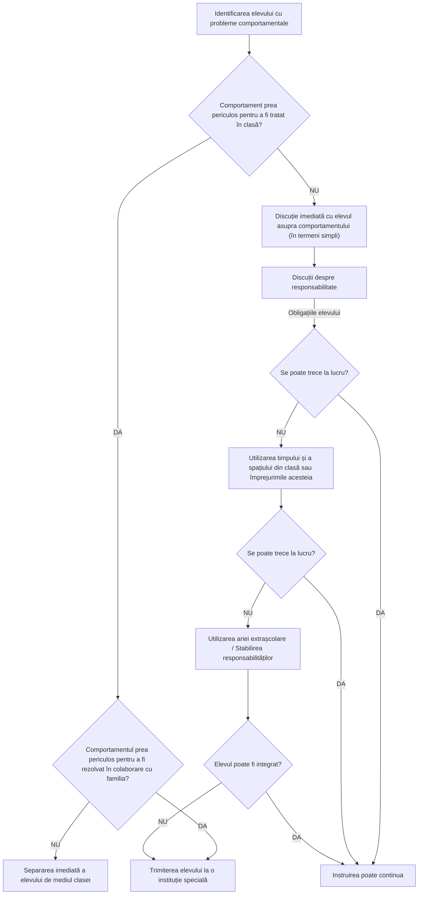

# Pagina 216 - Schema decizională a intervenției în abateri comportamentale

Ascultarea activă presupune o comunicare mai eficientă, bazată pe o ascultare atentă, comprehensibilă în voință și în fapt, la nivelul clasei de elevi.

Din perspectiva managerială, maniera de reprezentare grafică a abaterii comportamentale poate cunoaște următoarea formă:

### Schema decizională de intervenție în cazul abaterilor comportamentale (după Joane Freeman)

---

# Pagina 217 - Situații problematice și secvențe de asistență psihologică

Schema anterioară aparține lui Freeman Joane, *Pour une éducation de base de qualité* (UNESCO, Paris, 1993) și relevă pașii pe care-i poate urma cadrul didactic de la identificarea comportamentului „deviant” până la decizia de intervenție.

O altă perspectivă interesantă privitoare la analiza situațiilor problematice este cea a lui Kerner & Tregor, *„The Rational Manager”*, în Ioan Jinga, *Managementul educațional preuniversitar* (ARC, București, 1997). Autorii fac distincția între problemă și situație problematică, aceasta cuprinzând mai multe serii de probleme ce pot fi supuse unor metode algoritmice sau creative de soluționare. „Problemele” care compun o situație problematică pot fi încadrate în trei tipuri posibile:
- probleme de tip abatere;
- probleme de tip optimizare;
- probleme potențiale.

Intervenția în cazul situațiilor problematice presupune planificare în funcție de tipul problemei. Din punctul de vedere al intervenției, aspectele anterior prezentate îmbracă forma unei asistențe psihologice, descriptibilă prin următorii pași (vezi Laing, R.D., *Interpersonelle Wahrnehmung*, Frankfurt, 1994):
1. **Secvența diagnostic:** constatativă, furnizează date pentru identificarea problemelor, evaluarea și ierarhizarea, precum și elaborarea procedurilor de soluționare;
2. **Secvența formativ-profilactică:** vizează metode și acțiuni prin care cadrul didactic să învețe cum să abordeze exigențele și solicitările situației-problemă respective în scopul soluționării acesteia;
3. **Secvența terapeutico-recuperatorie:** îmbină deopotrivă elementele de consiliere și cele de psihoterapie; ambele au drept scop sprijinirea unei persoane aflate într-o situație critică.

Majoritatea abaterilor comportamentale în clasă nu sunt datorate unor patologii psihologice, cât mai ales unor tulburări adaptative și de comportament. Efectele posibile ale tulburărilor sau abaterilor comportamentale ale elevilor în clasă sunt eșecurile privind adaptarea și integrarea școlară, precum și delincvența juvenilă. Copiii cu probleme de integrare școlară se caracterizează prin:
- insubordonare în raport cu regulile și normele școlare;
- lipsa de interes față de cerințele și obligațiile școlare;
