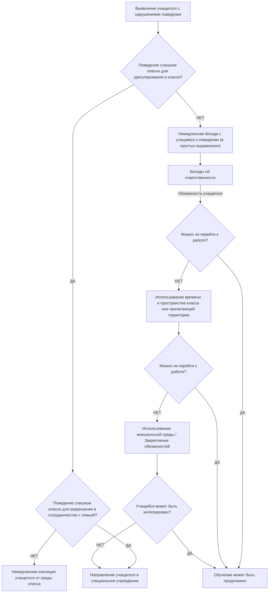

# Страница 216 - Схема принятия решений при поведенческих отклонениях

Активное слушание предполагает более эффективную коммуникацию, основанную на внимательном, искреннем и действенном слушании на уровне класса учащихся.

С управленческой точки зрения графическое представление реакции на поведенческое отклонение может иметь следующий вид:

### Схема принятия решений о вмешательстве при нарушениях поведения (по Джоан Фримен)

---

# Страница 217 - Проблемные ситуации и этапы психологической помощи

Приведенная выше схема принадлежит Джоан Фримен (Freeman Joane, *Pour une éducation de base de qualité*, UNESCO, Paris, 1993) и отражает последовательность шагов педагога от выявления «девиантного» поведения до решения о вмешательстве.

Другой интересный подход к анализу проблемных ситуаций предложен Кернером и Трего (Kerner & Tregor, *„The Rational Manager”*, в: Ioan Jinga, *Managementul educațional preuniversitar*, ARC, București, 1997). Авторы разграничивают понятие «проблема» и «проблемная ситуация», причем последняя включает в себя совокупность проблем, которые могут быть разрешены с помощью алгоритмических или творческих методов. «Проблемы», составляющие проблемную ситуацию, подразделяются на три возможных типа:
- проблемы типа отклонения;
- проблемы типа оптимизации;
- потенциальные проблемы.

Вмешательство при проблемных ситуациях предполагает планирование в зависимости от типа проблемы. С точки зрения вмешательства вышеизложенные аспекты принимают форму психологической помощи, описываемой следующими этапами (см. Laing, R.D., *Interpersonelle Wahrnehmung*, Frankfurt, 1994):
1. **Диагностический этап:** констатирующий, предоставляет данные для выявления проблем, их оценки и ранжирования, а также для выработки процедур разрешения;
2. **Формирующе-профилактический этап:** нацелен на методы и действия, с помощью которых педагог учится справляться с требованиями проблемной ситуации для ее разрешения;
3. **Терапевтическо-восстановительный этап:** объединяет элементы консультирования и психотерапии; оба направления служат поддержке человека, находящегося в критической ситуации.

Большинство поведенческих отклонений в классе обусловлено не психическими патологиями, а нарушениями адаптации и поведения. Возможными последствиями нарушений или отклонений в поведении учащихся являются срывы школьной адаптации и интеграции, а также подростковая делинквентность. Дети с проблемами школьной интеграции характеризуются:
- неподчинением школьным правилам и нормам;
- отсутствием интереса к школьным требованиям и обязанностям;
