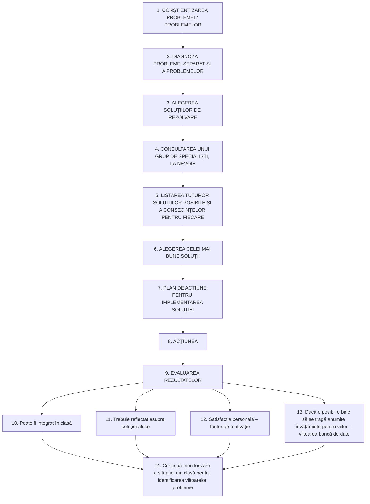

# Pagina 218 - Abaterile liniare, alergia școlară și cauzele manageriale

- absenteismul, repetenția, conduita agresivă.

Nivelul de adaptare și de integrare școlară poate fi analizat din punctul de vedere a doi indicatori mai importanți:
a. randamentul școlar;
b. gradul de satisfacție resimțit de elev.

Toate problemele specifice privitoare la situațiile de criză sunt, după cum am mai amintit, probleme „de tip abatere”, în care, plecându-se de la o situație inițială A către ținta B, datorită unei cauze (mai multor cauze) are loc o perturbare, o deviere de traiectorie, spre punctul B1, abătând sistemul de la parcursul preconizat. Abaterea comportamentală reprezintă deci această deviere a unui elev de la normele comportamentale stabilite în clasă, deviere soldată cu efecte în planul adaptării și integrării social-școlare a elevului respectiv.

În funcție de criteriile amintite în paragrafele preliminare ale acestui subcapitol, abaterile liniare (cele mai simple ca anvergură și consecințe în planul dezvoltării personalității) îmbracă frecvent și forma alergiei școlare (elevii care nu suportă școala) datorită unor cauze manageriale clare:
- profesori inapți, neimplicați și care nu respectă particularitățile de vârstă;
- profesori care nu fac eforturi de cunoaștere și de mobilizare a elevului;
- profesori autoritariști și agresivi;
- profesori inabili din punct de vedere managerial.

Toate aceste motivații reprezintă și o dezvoltare în plan educațional a unor cauze de tip managerial, pe care o pregătire deficitară a cadrului didactic le-ar putea induce.

În ceea ce privește momentele pertinente de intervenție și posibilele derulări ale acesteia, schema ce va urma și care va fi supusă atenției și studiului în paginile următoare, poate să probeze, încă o dată dacă mai era nevoie, că acțiunea respectivă este un demers interdisciplinar de anvergură socio-logică-psihologică-pedagogică și managerială, atât de frecvent uzitat încât un cadru didactic bun nu-și poate permite luxul de a-l rata.

---

# Pagina 219 - Schema etapelor intervenției educaționale (după Helmut Heiland)

### Intervenția Educațională

*(vezi Heiland Helmut, Schulpraktische Studien, Klinkhardt, Regensburg, 1993)*
