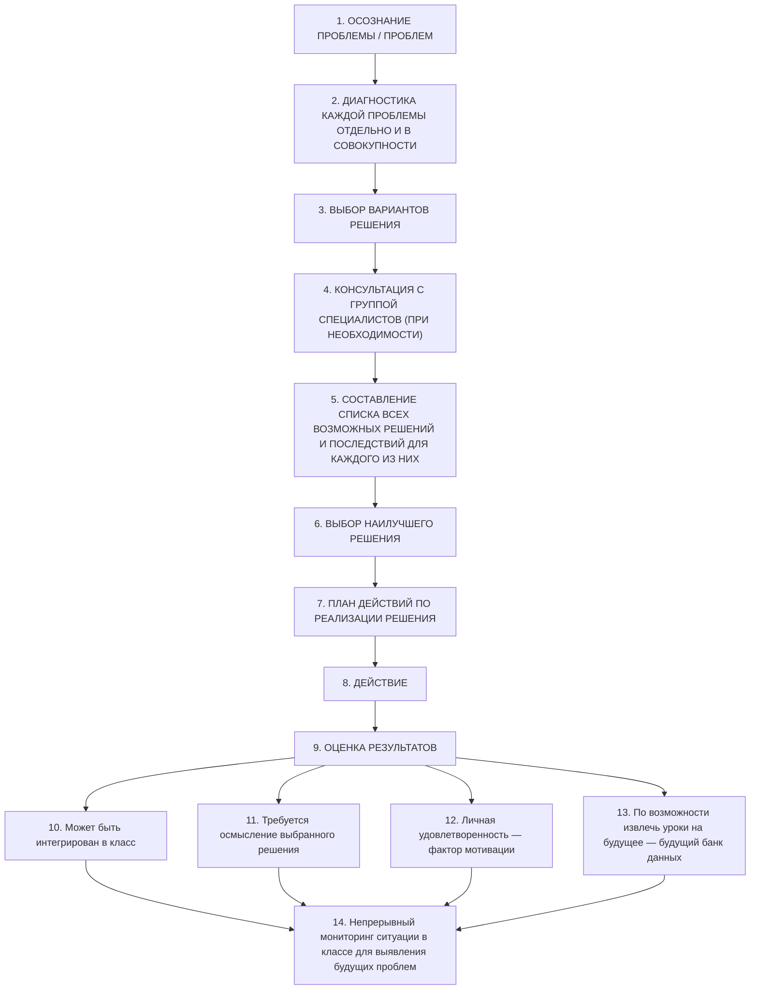

# Страница 218 - Линейные отклонения, школьная аллергия и управленческие причины

- прогулы (абсентеизм), второгодничество, агрессивное поведение.

Уровень школьной адаптации и интеграции может анализироваться с точки зрения двух важнейших показателей:
a. школьная успеваемость (продуктивность);
b. степень удовлетворенности, испытываемая учащимся.

Все специфические проблемы, относящиеся к кризисным ситуациям, являются, как уже отмечалось, проблемами «типа отклонения», при которых на пути от начальной ситуации A к цели B из-за одной или нескольких причин возникает сбой, отклонение траектории к точке B1, уводящее систему с намеченного пути. Поведенческое отклонение представляет собой отклонение учащегося от установленных в классе норм поведения, приводящее к последствиям в социально-школьной адаптации и интеграции данного ученика.

В соответствии с критериями, упомянутыми во вводной части данного подраздела, линейные отклонения (наиболее простые по масштабу и последствиям для развития личности) часто принимают форму школьной аллергии (неприятия школы учащимися) по понятным управленческим причинам:
- некомпетентные, безучастные педагоги, не учитывающие возрастные особенности;
- педагоги, не прикладывающие усилий для понимания и вовлечения ученика;
- авторитарные и агрессивные педагоги;
- педагоги, не обладающие управленческими навыками.

Все эти факторы представляют собой проявление в образовательном плане причин управленческого характера, порождаемых недостаточной подготовкой педагога.

Что касается ключевых моментов вмешательства и возможных сценариев его развертывания, приведенная ниже схема подтверждает, что данное действие представляет собой масштабный междисциплинарный социологический, психологический, педагогический и управленческий процесс, используемый настолько часто, что хороший педагог не может позволить себе роскошь упустить его из виду.

---

# Страница 219 - Схема этапов педагогического вмешательства (по Гельмуту Хайланду)

### Педагогическое вмешательство

*(см. Heiland Helmut, Schulpraktische Studien, Klinkhardt, Regensburg, 1993)*
