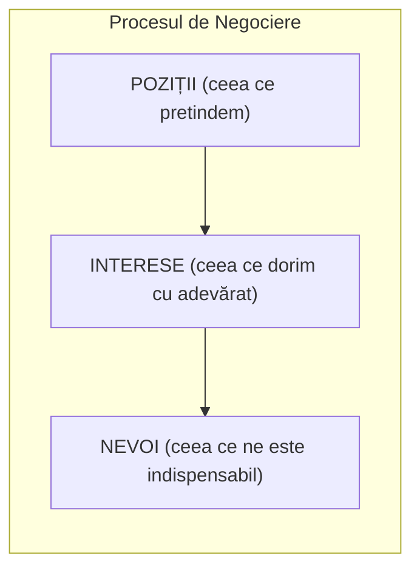

# Pagina 228 - Întrebări reflexive și modelul triunghiular al negocierii (P-I-N)

- **audierea conținutului** – concentrarea pe ceea ce se spune, și nu asupra modului în care se prezintă; trebuie să se pătrundă mai adânc în problema școlară respectivă;
- **concentrarea discuției pe conținut** – nu e bine să se abordeze comportamentul unui individ, ci mai ales procesul.

Totodată cadrul didactic ar trebui să-și pună câteva întrebări interesante legate de problematica unui conflict. Aceste chestiuni ar fi bine să fie puse în limbaj interior:
- *Ce câștig personal și ce câștigă clasa evitând conflictul?*
- *Care sunt costurile personale și cele de grup în cazul evitării conflictului?*
- *Ce urmări de durată ar avea una sau alta dintre cele două alternative?*
- *Cum ar arăta imaginea de durată a relațiilor interpersonale la nivelul grupului-clasă?*

Răspunsurile obținute la toate aceste întrebări pot să contureze o eventuală strategie de intervenție. Propunerea noastră este atât de nivel preventiv, cât și de nivel intervenționist, sub formă de negociere.

*Negocierea* este o construcție subiectivă a unei înțelegeri comune printr-o raportare inteligentă la poziții, interese și nevoi (Acland Andrew Floyer, *Negocierea*, Editura Național, București, 1998; Souui Hassan, *Manipularea în negocieri*, Editura Antet, București, 1998).

Potrivit acelorași autori, reprezentarea grafică a procesului de negociere poate fi făcută astfel:

### Modelul PIN (Poziții – Interese – Nevoi)



În dinamica relațională dintre cele două părți negociatoare:
- **Pozițiile (P)** sunt vizibile la suprafață, divergente și greu de conciliat;
- **Interesele (I)** încep să se intersecteze (*interese comune*);
- **Nevoi fundamentale (N)** au o arie largă de suprapunere (*nevoi comune*).

---

# Pagina 229 - Triunghiul P-I-N și axa strategiilor de rezolvare a conflictului

### Continuul strategiilor de negociere și gestionare a conflictului

```text
               Concurența <------------ Compromisul ------------> Colaborarea
                   :                                                    :
                   :                                                    :
               Evitarea <----------------------------------------> Acceptarea
```

Triunghiul **P – I – N** are ca legendă:
- **P = poziții** (unghiul de abordare a situației);
- **I = interese** (lucruri pe care avem tendința să le facem întrucât ne fac plăcere);
- **N = nevoi** (aspecte a căror obișnuință oamenii încearcă să o evite pentru că este dureroasă).

În situația în care **I = N**, deci interesele și nevoile coincid, se poate spune că s-a creat deja terenul unei înțelegeri. Înaintarea către înțelegerea finală, în acest spațiu contextual, se realizează deja mult mai ușor. Se recomandă astfel deturnarea atenției de la poziții la nevoi și la interese, fapt care face ca acestea din urmă să fie mai bine vizualizate în timp ce pozițiile pot fi neglijate.

În situația în care **I ≠ N**, deci interesele și nevoile nu se confundă, se poate spune că interesele călăuzesc, dar că nevoile conduc. Aceeași specialiști evocați anterior (Acland și Souui) afirmă că, în timp ce interesele sunt întotdeauna negociabile, nevoile, prin definiție, nu se negociază. Dacă ceva se negociază atunci se poate spune cu certitudine că aceea nu este o necesitate. Numai un conflict poate scoate la lumină nevoile (nevoia „de a-și susține drepturile”, „nevoia de a fi auzit”). Nevoile pot fi reprimate, dar nu pot dispărea. Atât nevoile, cât și interesele pot fi materiale sau abstracte.

Reușita într-o negociere educațională se obține prin ideea generală că pentru a dobândi ceva, trebuie să acorzi partenerilor șansa de a obține și ei ceea ce vor, și chiar mai mult, prin prezentarea încă de la început a intenției și a disponibilităților de negociere.
