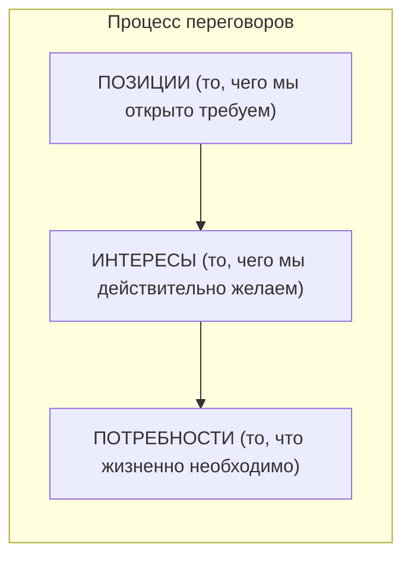

# Страница 228 - Внутренние вопросы педагога и треугольная модель переговоров (P-I-N)

- **выслушивание содержания** — концентрация на том, *что* говорится, а не на том, *как* это преподносится; необходимо глубже вникать в суть школьной проблемы;
- **сосредоточение дискуссии на содержании** — не следует фиксироваться на личности учащегося, в фокусе должен быть сам процесс.

Педагогу полезно задать себе ряд важных вопросов относительно природы конфликта во внутреннем диалоге:
- *Что выиграю лично я и что выиграет класс от избегания конфликта?*
- *Каковы личные и групповые издержки при уклонении от конфликта?*
- *Каковы долгосрочные последствия каждой из двух альтернатив?*
- *Как будет выглядеть долгосрочная перспектива межличностных отношений в классе?*

Ответы на эти вопросы формируют контур стратегии вмешательства. Наше предложение охватывает как превентивный, так и интервенционный уровень в формате переговоров.

*Переговоры* представляют собой субъективное конструирование общего согласия через разумное соотнесение позиций, интересов и потребностей (Acland Andrew Floyer, *Negocierea*, Editura Național, București, 1998; Souui Hassan, *Manipularea în negocieri*, Editura Antet, București, 1998).

По мнению авторов, графическая модель процесса переговоров может быть представлена следующим образом:

### Модель PIN (Позиции – Интересы – Потребности)



Во взаимодействии договаривающихся сторон:
- **Позиции (P)** находятся на поверхности, они противоположны и трудносогласуемы;
- **Интересы (I)** начинают пересекаться (*общие интересы*);
- **Базовые потребности (N)** обладают широкой зоной совпадения (*общие потребности*).

---

# Страница 229 - Треугольник P-I-N и шкала стратегий разрешения конфликтов

### Континуум стратегий ведения переговоров и управления конфликтом

```text
               Соперничество <---------- Компромисс ----------> Сотрудничество
                     :                                                 :
                     :                                                 :
                 Избегание <------------------------------------> Приспособление
```

Условные обозначения треугольника **P – I – N**:
- **P = позиции** (угол зрения, ракурс подхода к ситуации);
- **I = интересы** (то, к чему мы склонны, поскольку это приносит нам удовлетворение);
- **N = потребности** (факторы, ущемления которых люди стараются избегать, так как это болезненно).

В ситуации, когда **I = N** (интересы и потребности совпадают), почва для договоренности уже создана. Движение к окончательному согласию в таком контексте происходит гораздо легче. Рекомендуется переключать внимание с позиций на потребности и интересы: последние становятся более очевидными, а сами позиции отходят на второй план.

В ситуации, когда **I ≠ N** (интересы и потребности расходятся), интересы направляют, но правят потребности. Авторы (Экланд и Сууи) подчеркивают: если интересы всегда подлежат обсуждению, то потребности по определению предмету торга не подлежат. Если что-то поддается торгу, это определенно не базовая потребность. Лишь конфликт способен вскрыть истинные потребности (потребность «отстоять права», «быть услышанным»). Потребности можно подавить, но они не исчезают. И потребности, и интересы могут быть материальными либо абстрактными.

Успех педагогических переговоров зиждется на правиле: чтобы получить желаемое, необходимо предоставить партнерам возможность получить то, к чему стремятся они, открыто демонстрируя готовность к диалогу с самого начала.
