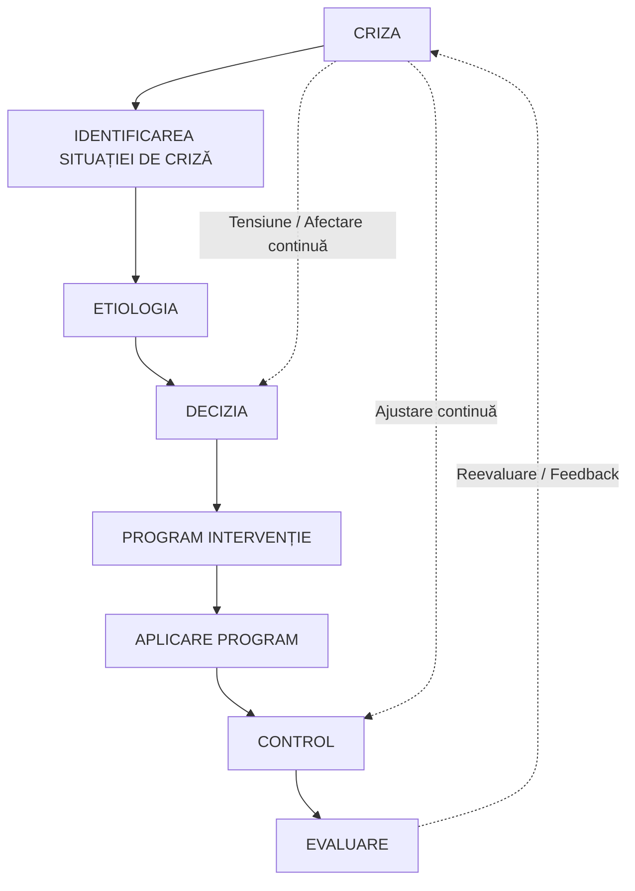
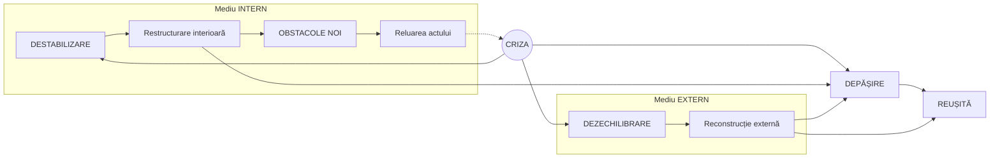

# Pagina 198 - Controlul și Evaluarea în gestiunea crizei

### 6.2.6. Controlul

Trebuie să însoțească orice demers acțional. Importanța acestuia constă în grija pentru localizarea cât mai fidelă a fenomenului, evitarea și prevenirea altor efecte ale crizei sau chiar micro-crize paralele. De asemenea, diversitatea procedurilor folosite, multe dintre ele fără o pretestare anterioară, solicită o ajustare permanentă a lor din mers fără stagnări și pauze. Cursivitatea intervențiilor, gradul de omogenitate și coerență sunt verificate și optimizate prin intermediul controlului.

### 6.2.7. Evaluarea

Are în vedere măsurarea și aprecierea stării finale a clasei în urma încheierii demersurilor rezolutive. E bine să fie configurate seturi de indicatori relevanți pentru a evita distorsiunile în apreciere și pentru certificarea nivelului final. O întrebare se ridică însă aici: *când se poate spune despre o criză că s-a finalizat?* Nivelurile de conștiință ale indivizilor fiind foarte diferite, iar efectele cu care criza s-a soldat nefiind prea ușor de creionat, nici starea finală (cum la fel de greu se creionează și cea inițială) nu este simplu de evaluat.

Un obiectiv esențial al etapei evaluative îl constituie concluziile inferate în urma impactului cu starea de criză și angajarea tuturor celor implicați în acțiuni de cunoaștere și de prevenire a viitoarelor situații de acest gen. Semnificația acordată evenimentului critic trebuie să constituie un fundament temeinic de învățare. Un cadru didactic bun, cu experiență, dar și cu calități manageriale evidente va putea să exploateze întreaga desfășurare a evenimentelor în favoarea dezvoltării ulterioare a organizației, a eficientizării demersurilor sale personale, dar și pentru sporirea productivității clasei. O criză poate să fie așadar formativă pentru că, după cum s-a putut observa, ea îndeplinește și o serie de funcțiuni ameliorative, dependente de competențele manageriale.

Viața contemporană trepidantă și bulversantă, chiar și în mediile școlare, obligă cadrele didactice să conviețuiască cu stările de criză, manifestând însă o atenție crescută față de toate simptomele și stările incipiente declanșatoare ale acestora. Totodată, orice cadru didactic performant, trebuie să-și formeze încă o strategie de intervenție managerială în cadrul activității educaționale: **gestionarea stărilor de criză apărute în activitatea instructiv-educativă cu clasa de elevi**.

---

# Pagina 199 - Diagrame: Etapele gestionării crizei și dinamica acesteia

### Schema etapelor de gestionare a crizei educaționale

---

### Dinamica apariției și stingerii crizei educaționale (după Corsini / Ullich)

*(Conform schemei din lucrare: Criza se manifestă atât în mediul intern, provocând destabilizare și necesitând restructurare interioară, cât și în mediul extern, provocând dezechilibrare și impunând reconstrucție externă. Depășirea crizei duce la reușită, în timp ce apariția de noi obstacole impune reluarea actului educațional-managerial).*
