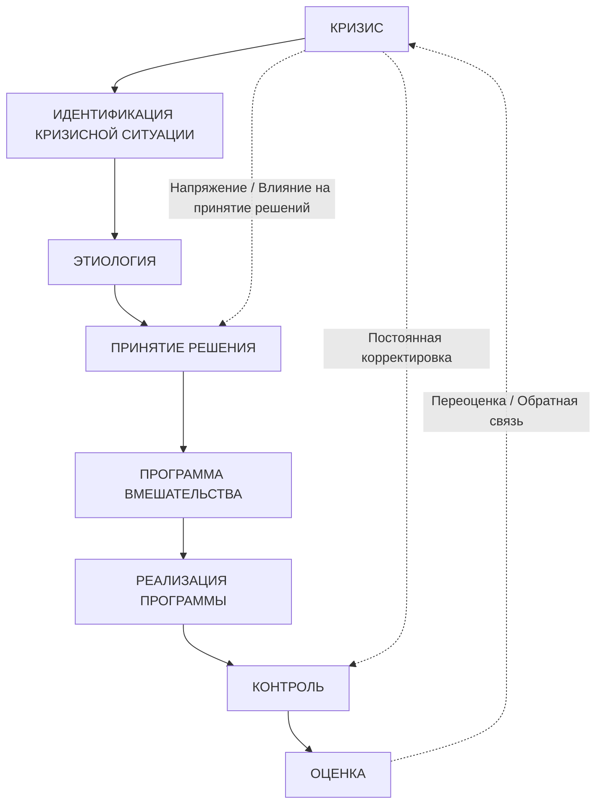
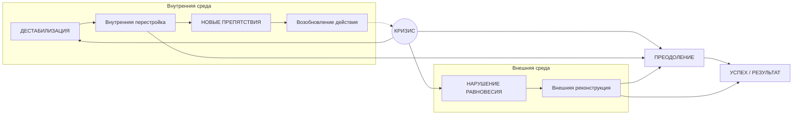

# Страница 198 - Контроль и Оценка в управлении кризисом

### 6.2.6. Контроль

Должен сопровождать любое практическое действие. Его важность заключается в заботе о максимально точной локализации явления, предотвращении и предупреждении вторичных последствий кризиса или даже параллельных микрокризисов. Кроме того, разнообразие применяемых процедур, многие из которых не прошли предварительной апробации, требует их постоянной корректировки на ходу, без задержек и пауз. Плавность, согласованность и степень однородности мер проверяются и оптимизируются именно посредством контроля.

### 6.2.7. Оценка

Направлена на измерение и определение итогового состояния класса после завершения мер по урегулированию ситуации. Целесообразно сформировать систему релевантных показателей во избежание искажений в оценках и для подтверждения достигнутого конечного уровня. Однако здесь возникает вопрос: *когда можно с уверенностью сказать, что кризис завершился?* Уровни осознания у отдельных людей крайне различны, а последствия кризиса очертить непросто, поэтому итоговое состояние (как и начальное) оценить весьма затруднительно.

Важнейшей целью оценочного этапа выступают выводы, сделанные по итогам столкновения с кризисным состоянием, и вовлечение всех участников в процесс осмысления и предотвращения подобных ситуаций в будущем. Значение, придаваемое критическому событию, должно стать прочной основой для обучения и развития. Опытный педагог с выраженными управленческими качествами сумеет использовать весь ход событий во благо дальнейшего развития школьной организации, повышения эффективности собственной работы и роста результативности класса. Таким образом, кризис может нести формирующую функцию, поскольку выполняет ряд мелиоративных (улучшающих) задач, зависящих от управленческой компетентности учителя.

Бурный и напряженный ритм современной жизни, в том числе в школьной среде, обязывает учителей сосуществовать с кризисными состояниями, проявляя повышенную бдительность ко всем зарождающимся симптомам и первичным факторам их возникновения. Вместе с тем каждый успешный педагог должен сформировать еще одну управленческую стратегию в своей педагогической деятельности: **управление кризисными состояниями, возникающими в учебно-воспитательном процессе в классе учащихся**.

---

# Страница 199 - Схемы: Этапы управления кризисом и динамика кризисной ситуации

### Схема этапов управления педагогическим кризисом

---

### Динамика возникновения и преодоления педагогического кризиса (по Корсини / Уллиху)

*(Пояснение к схеме: Кризис проявляется как во внутренней среде класса, вызывая дестабилизацию и требуя внутренней перестройки, так и во внешней среде, нарушая баланс и требуя внешней реконструкции. Успешное преодоление кризиса ведет к позитивному результату, тогда как появление новых препятствий требует возобновления управленческо-педагогического акта).*
